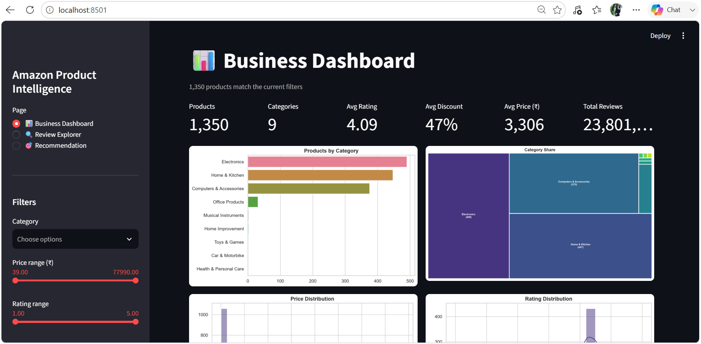
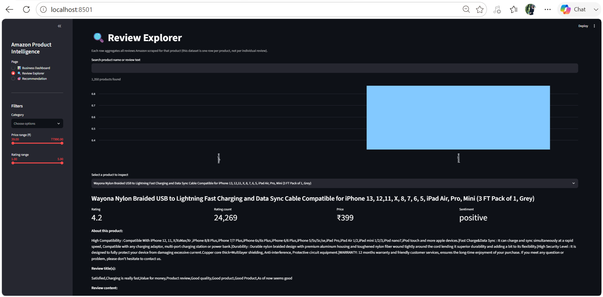
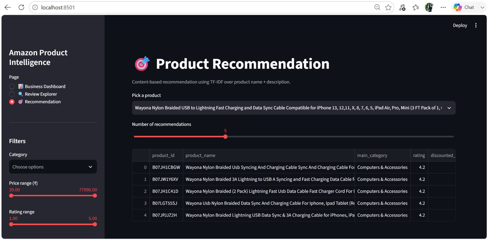

# Amazon Product Intelligence

> An end-to-end data science project on Amazon India product & review data: cleaning,
> exploratory analysis, statistical testing, NLP, sentiment analysis, machine learning,
> a content-based recommendation system, and an interactive Streamlit dashboard.

**Status:** ✅ Phases 0–8 complete (repo setup → dashboard). Phase 9 (this README + `docs/`) in progress.

## Table of Contents
- [Project Overview](#project-overview)
- [Objectives](#objectives)
- [Dataset](#dataset)
- [Project Architecture](#project-architecture)
- [Repository Structure](#repository-structure)
- [Installation](#installation)
- [Methodology](#methodology)
- [Results](#results)
- [Dashboard Demo](#dashboard-demo)
- [Optional Dependencies & Graceful Fallbacks](#optional-dependencies--graceful-fallbacks)
- [Roadmap](#roadmap)
- [Future Work](#future-work)

## Project Overview

Amazon's product catalog data — prices, discounts, ratings, and customer
reviews — contains rich signal about what sells, what satisfies customers,
and what doesn't. This project builds a complete, reproducible data science
pipeline around a real Amazon India product/review dataset, taking it from a
messy raw CSV all the way to a deployable interactive dashboard, mirroring
the workflow of a production data science engagement rather than a one-off
notebook analysis.

Every phase is implemented twice, deliberately: once as a production-style
Python module in `src/` (importable, logged, unit-testable), and once as a
Jupyter notebook in `notebooks/` that calls into that module to demonstrate
and visualize the results with narrative commentary. Notebooks never
duplicate logic — they are thin wrappers, so there is exactly one place each
piece of business logic lives.

The project was built and validated by actually running every module against
the real dataset at each phase, not just writing code that "should" work.
This surfaced several genuine bugs along the way (a category-name splitting
bug, a punctuation-stripping bug that merged adjacent words, leaked image
URLs inside review text, a feature-importance array-length mismatch, and a
regex-injection bug in the recommender's product lookup) — all documented
and fixed in `docs/methodology.md` and the relevant notebooks, as a record of
what real-world data cleaning and pipeline-building actually looks like.

## Objectives

1. Clean and structure raw Amazon product/review data into an analysis-ready form.
2. Explore pricing, rating, category, and discount patterns through 18+ visualizations.
3. Test business hypotheses statistically (rating vs. category, discount vs. rating, etc.).
4. Mine review text for keywords, topics, and n-gram patterns.
5. Classify review sentiment and compare a rule-based baseline against a transformer model.
6. Build rating classification/regression models with explainability.
7. Build a content-based recommendation system.
8. Ship an interactive Streamlit dashboard exposing all of the above.

## Dataset

Source file: `data/raw/amazon.csv` — 1,465 Amazon India product listings
(1,351 after de-duplicating on `product_id` in Phase 1). Each row aggregates
one product's pricing, rating, category, description, and *all* of its
scraped customer reviews (review fields are comma-joined across multiple
reviews per product, rather than one row per individual review).

| Column | Description |
|---|---|
| `product_id` | Unique product identifier |
| `product_name` | Product title |
| `category` | Pipe-delimited category hierarchy, e.g. `Electronics\|Mobiles&Accessories\|...` |
| `discounted_price` | Current selling price (₹), raw format `"₹1,099"` |
| `actual_price` | List price before discount (₹) |
| `discount_percentage` | Discount applied, raw format `"64%"` |
| `rating` | Average star rating (1–5) |
| `rating_count` | Number of ratings, raw format `"24,269"` |
| `about_product` | Bullet-point product description |
| `user_id` / `user_name` | Reviewer identifiers (comma-joined, multiple per product) |
| `review_id` / `review_title` / `review_content` | Review text fields (comma-joined) |
| `img_link` / `product_link` | Media / source URLs |

Engineered features added during Phase 1 (see [Methodology](#methodology))
include `main_category`/`sub_category`/`product_type`, `*_clean` text
columns, `discount_amount`, `review_length`/`title_length`/
`description_length`, `popularity_score`, and `price_bucket`/
`discount_bucket`. The catalog is dominated by three categories — Electronics
(490 products), Home & Kitchen (448), and Computers & Accessories (375) —
with a long tail of categories represented by only 1–31 products each; this
imbalance is called out wherever it affects interpretation (e.g. category
rating comparisons in `docs/results.md`).

## Project Architecture

```
                 ┌────────────────────┐
                 │  data/raw/          │
                 │  amazon.csv          │
                 └──────────┬──────────┘
                            │  src/preprocessing.py
                            ▼
                 ┌────────────────────┐
                 │  cleaned_products    │  ← dedup, price/rating parsing,
                 │  .csv                 │    category split, text cleaning
                 └──────────┬──────────┘
                            │  src/feature_engineering.py
                            ▼
                 ┌────────────────────┐
                 │  products_features   │  ← discount_amount, *_length,
                 │  .csv                  │    popularity_score, buckets
                 └──────────┬──────────┘
                            │
        ┌────────┬─────────┼─────────┬─────────┬─────────┐
        ▼        ▼         ▼         ▼         ▼         ▼
     eda.py  statistics  nlp.py  sentiment  machine_    recommen-
             .py                 .py        learning.py  dation.py
        │        │         │         │         │         │
        └────────┴─────────┴─────────┴─────────┴─────────┘
                            │
                            ▼
                 ┌────────────────────┐
                 │  outputs/figures/,    │  ← 27+ charts, model metrics,
                 │  models/, reports/    │    recommendation tables
                 └──────────┬──────────┘
                            │
                            ▼
                 ┌────────────────────┐
                 │  dashboard/           │  ← Streamlit app: 3 interactive
                 │  streamlit_app.py     │    pages over the same src/ modules
                 └────────────────────┘
```

Each `src/` module is independently runnable (`python src/<module>.py`) and
independently imports only what it needs from earlier stages — there's no
hidden global state, and every module falls back gracefully if an optional
dependency isn't installed (see [Optional Dependencies](#optional-dependencies--graceful-fallbacks)).

## Repository Structure
```
amazon-product-intelligence/
├── README.md
├── requirements.txt
├── environment.yml
├── .gitignore
├── LICENSE
├── data/
│   ├── raw/                   amazon.csv
│   └── processed/              cleaned_products.csv, products_features.csv
├── notebooks/
│   ├── 01_data_cleaning.ipynb
│   ├── 02_eda.ipynb
│   ├── 03_statistics.ipynb
│   ├── 04_nlp.ipynb
│   ├── 05_sentiment.ipynb
│   ├── 06_machine_learning.ipynb
│   ├── 07_recommendation.ipynb
│   └── 08_dashboard_demo.ipynb
├── src/
│   ├── preprocessing.py
│   ├── feature_engineering.py
│   ├── eda.py
│   ├── statistics.py
│   ├── nlp.py
│   ├── sentiment.py
│   ├── machine_learning.py
│   ├── recommendation.py
│   ├── visualization.py
│   └── utils.py
├── dashboard/
│   └── streamlit_app.py
├── outputs/
│   ├── figures/                27+ generated charts
│   ├── reports/
│   ├── models/
│   └── recommendations/
└── docs/
    ├── methodology.md
    ├── results.md
    └── figures/
      ├── dashboard_business.png
      ├── dashboard_reviews.png
      ├── dashboard_recommendation.png
```

## Installation
```bash
python -m venv .venv
source .venv/bin/activate   # Windows: .venv\Scripts\activate
pip install -r requirements.txt
```

Regenerate the full processed dataset and every chart from scratch:
```bash
python src/feature_engineering.py   # runs preprocessing.py internally
python src/eda.py
python src/statistics.py
python src/nlp.py
python src/sentiment.py
python src/machine_learning.py
python src/recommendation.py
streamlit run dashboard/streamlit_app.py
```

## Methodology

Full write-up: [`docs/methodology.md`](docs/methodology.md). Summary by phase:

- **Phase 1 — Cleaning & Feature Engineering:** parsed `₹`/comma-formatted
  numeric fields; split `category` into `main_category`/`sub_category`/
  `product_type` with CamelCase/acronym-aware regex; cleaned text (URL/HTML/
  emoji/punctuation stripping, stopword removal, lemmatization with an
  NLTK-optional fallback); engineered `discount_amount`, length features,
  `popularity_score`, and price/discount buckets.
- **Phase 2 — EDA:** 7 sections (overview, category, pricing, rating,
  discount, popular products, correlation), 18 charts, including a
  from-scratch squarified treemap implementation.
- **Phase 3 — Statistics:** 5 hypothesis tests (Kruskal-Wallis, ANOVA,
  Spearman, Pearson, Mann-Whitney) via `scipy.stats`, each reported with
  H0/H1/statistic/p-value/interpretation.
- **Phase 4 — NLP:** n-gram frequency, word cloud (with fallback), TF-IDF
  keywords per category, 6-topic NMF topic modelling.
- **Phase 5 — Sentiment:** rule-based baseline (VADER or fallback lexicon)
  with an optional DistilBERT transformer comparison.
- **Phase 6 — Machine Learning:** rating classification (`high_rated` ≥ 4.2)
  and regression, with SHAP-or-permutation feature importance, and an
  explicit leakage guard excluding `popularity_score` from features.
- **Phase 7 — Recommendation:** TF-IDF content-based recommender with an
  optional Sentence-Transformer embedding variant, evaluated via
  category-precision@k.
- **Phase 8 — Dashboard:** a 3-page Streamlit app whose data logic is
  decoupled from its UI layer for testability.

## Results

Full write-up, organized by business question, with all supporting numbers:
[`docs/results.md`](docs/results.md). Headlines:

- **Category matters for rating** (Kruskal-Wallis, p ≈ 2×10⁻¹²): among
  categories with substantial sample sizes, Computers & Accessories rates
  highest (4.15/5), ahead of Electronics (4.08) and Home & Kitchen (4.04).
- **Bigger discounts don't buy popularity** — discount % correlates weakly
  *negatively* with both rating and `popularity_score` (Pearson r = −0.165,
  p ≈ 9.9×10⁻¹⁰), and discounting strategy itself varies sharply by category
  (58% avg. discount in Home Improvement vs. 0% in Toys & Games).
- **Reviews skew strongly positive** (97.8% positive on the sentiment
  baseline), consistent with a 4.09/5 average rating across the catalog.
- **The content-based recommender works well**: category-precision@5 = 0.94
  across 200 sampled products; a sample query for a Wayona USB cable returns
  five closely related cables with similarity scores above 0.74.
- **Rating is hard to predict from price/discount/category/text alone**:
  Random Forest reaches ROC-AUC 0.775 for classifying "high-rated" products,
  but regression R² tops out at 0.11 — an informative negative result
  suggesting product quality and reputation (not captured in this feature
  set) drive rating more than pricing strategy does.

## Dashboard Demo

`dashboard/streamlit_app.py` — run with `streamlit run dashboard/streamlit_app.py`:

1. **📊 Business Dashboard** — KPI cards (products, avg. rating/discount/price,
   total reviews) plus category, pricing, rating, and correlation charts, all
   filterable live by category and price range via the sidebar.
   
   The Business Dashboard provides an interactive overview of the Amazon India product catalogue through KPI cards, category filters, pricing analysis, rating distributions, discount analysis, and correlation visualisations. All charts update dynamically based on the selected filters.
2. **🔍 Review Explorer** — search by product name or review text, filter by
   rating, see the sentiment mix for the filtered set, and drill into any one
   product's full review text and sentiment label.
   
   The Review Explorer allows users to search products by name or review content, filter products by rating, inspect the sentiment distribution of the filtered results, and read the aggregated customer reviews for an individual product.
3. **🎯 Recommendation** — pick any product from the full catalog and get its
   top-k TF-IDF content-based recommendations.
   
   The Recommendation Dashboard demonstrates the TF-IDF content-based recommendation engine. Users can select any product from the catalogue and receive the top-k most similar products together with similarity scores.

The app's filtering/KPI/sentiment logic is implemented as plain,
Streamlit-independent functions (`filter_products`, `compute_kpis`,
`sentiment_distribution` in `dashboard/streamlit_app.py`), so it can be
sanity-checked with `python dashboard/streamlit_app.py` — no server required.
See `notebooks/08_dashboard_demo.ipynb` for a walkthrough.

## Optional Dependencies & Graceful Fallbacks

Several later-phase features use optional packages that require network
access to install or download model weights. Each has a working fallback so
the pipeline never breaks — install the real package any time to upgrade
quality with no code changes:

| Feature | Preferred package | Fallback used here |
|---|---|---|
| Stopwords/lemmatization | `nltk` | Built-in stopword list, no lemmatization |
| Word cloud image | `wordcloud` | Top-terms bar chart |
| Sentiment baseline | `vaderSentiment` | Small built-in pos/neg lexicon scorer |
| Transformer sentiment | `transformers` + `torch` | Skipped (logged), VADER/fallback still runs |
| Embedding recommender | `sentence-transformers` | TF-IDF recommender (fully functional) |
| XGBoost classifier/regressor | `xgboost` | `GradientBoostingClassifier`/`Regressor` (sklearn) |
| SHAP explainability | `shap` | `sklearn.inspection.permutation_importance` |

## Roadmap
- [x] Phase 0 — Repository setup
- [x] Phase 1 — Data cleaning & feature engineering
- [x] Phase 2 — EDA (18 charts across overview/category/pricing/rating/discount/popularity/correlation)
- [x] Phase 3 — Statistical analysis (5 hypothesis tests)
- [x] Phase 4 — NLP review analysis (n-grams, wordcloud, TF-IDF, topic modelling)
- [x] Phase 5 — Sentiment analysis (rule-based baseline + optional transformer comparison)
- [x] Phase 6 — Machine learning models (classification + regression + feature importance)
- [x] Phase 7 — Recommendation system (TF-IDF; Sentence-Transformer optional)
- [x] Phase 8 — Streamlit dashboard (3 pages: Business, Review Explorer, Recommendation)
- [x] Phase 9 — Full README + documentation + results

## Future Work
- LLM-based natural-language explanations for individual recommendations.
- Collaborative filtering to complement the content-based recommender once
  per-user interaction data is available (this dataset is product-level only).
- Swap in real XGBoost/SHAP/sentence-transformers/DistilBERT where this
  build used documented fallbacks, and re-run the affected notebooks to
  compare fallback vs. full-dependency results directly.
- Expand the category taxonomy analysis to account for the long-tail
  category imbalance noted in [Dataset](#dataset).
